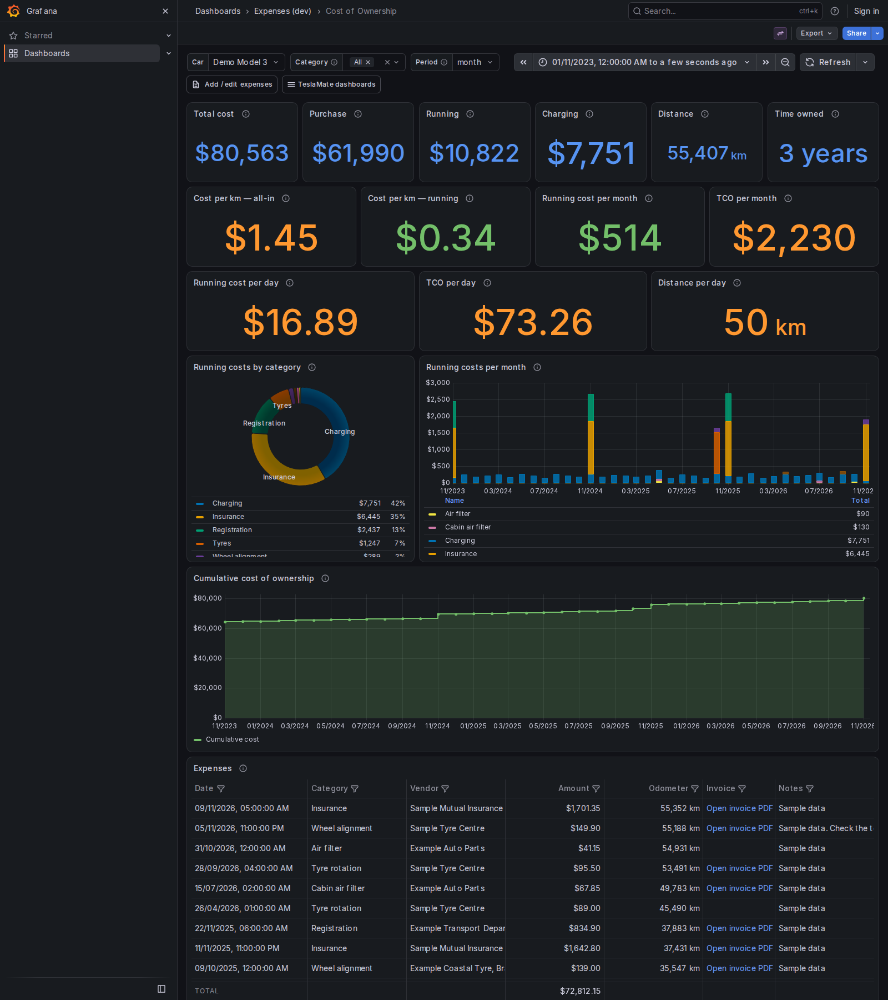
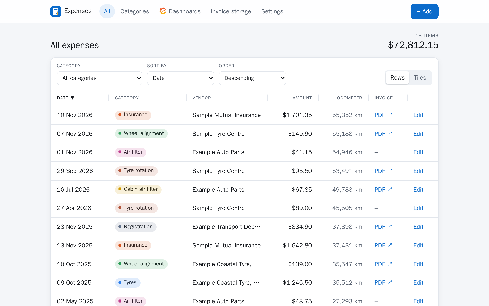

<p align="center"></p>

<h1 align="center">GarageBooks</h1>

<p align="center">Track what your Tesla costs to own: expenses, invoices and total cost of ownership in Grafana.</p>

<p align="center">
  <a href="https://github.com/mattew124/garagebooks/actions/workflows/ci.yml"></a>
  <a href="https://github.com/mattew124/garagebooks/releases"></a>
  <a href="https://github.com/mattew124/garagebooks/pkgs/container/garagebooks"></a>
  <a href="LICENSE"></a>
  <a href="https://mattew124.github.io/garagebooks/"></a>
  
</p>

> **Vibe coded.** This project was written with an AI coding assistant (Claude Code), directed
> and tested by a person, not hand-written or audited line by line. It has tests, runs in a
> read-only, non-root container and only writes inside its own `expenses` schema, but treat it as you
> would any young, unreviewed software: back up your TeslaMate database before first use, and
> read the code before you trust it with anything you care about.
>
> This project is an unofficial community tool and is not affiliated with, endorsed by, or supported by the official TeslaMate project. It reads data from a [TeslaMate](https://github.com/teslamate-org/teslamate) database. Not affiliated with Tesla, Inc.
>
> OneDrive is a trademark of Microsoft Corporation and Grafana is a trademark of Grafana Labs. This project is not affiliated with or endorsed by either. The OneDrive and Grafana logos are fetched at runtime from [selfh.st/icons](https://selfh.st/icons) ([CC BY 4.0](https://creativecommons.org/licenses/by/4.0/)); they are not part of this repository.

- **Web UI** (Flask) to add/edit expenses: category, date, time, amount, odometer, vendor,
  notes and a link to the PDF invoice in your cloud storage. The odometer can be filled in from
  TeslaMate's own position data for the chosen date and time.
- **Optional OneDrive upload**: choose the invoice PDF in the form and it goes into that car's
  OneDrive folder, with the link filled in for you.
- **Or keep invoices on your own server**: mount a folder (a NAS share, say) and the app saves the
  PDFs there, per car and category, and shows them itself behind your login.
- **Postgres schema** `expenses` inside the TeslaMate database, so Grafana joins it to
  TeslaMate's charging costs and odometer with no second datasource.
- **Grafana dashboard** "Cost of Ownership": total cost of ownership, purchase vs running
  vs charging, cost per km, per day and per month, monthly spend by category, cumulative cost, and
  a table of every expense with a clickable invoice link.

<p align="center"></p>

<p align="center"></p>

<sub>Screenshots use invented data.</sub>

```
 browser ──► proxy + forward-auth ──► expenses (Flask/gunicorn) ──► TeslaMate Postgres
                                                                       ▲   schema `expenses`
                                     Grafana (TeslaMate datasource) ───┘   + public.* (read-only)
```

## Documentation

**[https://mattew124.github.io/garagebooks/](https://mattew124.github.io/garagebooks/)** covers setup, OneDrive uploads, importing invoices, what the dashboard counts,
and development.

## Quick start

The app has **no login of its own**. Only publish it behind a forward-auth gate, such as Authentik
or Authelia with Traefik. `docker-compose.traefik.yml` refuses to start without one.

Back up TeslaMate's database first: the first start adds the `expenses` schema to it and changes
nothing else.

Contributions are welcome: see [CONTRIBUTING.md](CONTRIBUTING.md) first.

```bash
cp .env.example .env    # set DATABASE_USER and DATABASE_PASS to TeslaMate's
docker compose up -d    # localhost:8088/expenses/
```

Then add the dashboard to TeslaMate's Grafana, and optionally turn on OneDrive uploads:
see [Setup](https://mattew124.github.io/garagebooks/setup/).

## TeslaMate version

Tested with TeslaMate 4.4.0. TeslaMate has no stable database schema, so the app stops on start
if the database is from a newer TeslaMate than that, rather than showing wrong numbers
(`ALLOW_UNTESTED_TESLAMATE=1` overrides it). A weekly check tests each new TeslaMate release.

## License

MIT. `db/teslamate-schema.sql` is generated from [TeslaMate](https://github.com/teslamate-org/teslamate)'s
table definitions (AGPL-3.0).
