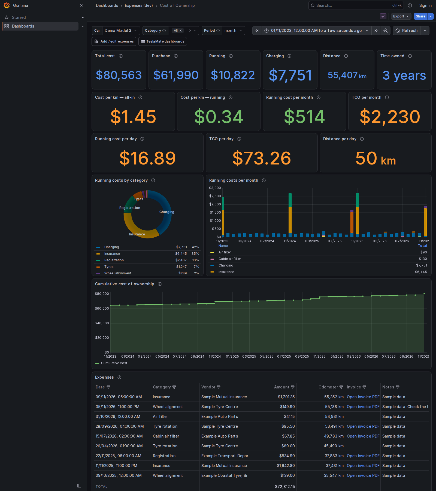

# What the dashboard counts

The **Cost of Ownership** dashboard sits in Grafana's **Expenses** folder (see step 6 of
[Setup](setup.md)). Its two links go to the app (**Add / edit expenses**) and back to TeslaMate's
own dashboards.

## The figures

All of them come from the `expenses.ownership` view (`garagebooks/schema.sql`), one row per car:

| Figure | Definition |
|---|---|
| Total cost | purchase + running expenses + `charging_processes.cost` |
| Distance | latest odometer − odometer on the purchase expense (else the first odometer TeslaMate saw) |
| Cost per km — all-in | total cost ÷ distance |
| Cost per km — running | (running + charging) ÷ distance, excludes the purchase price |
| Per day and per month | running (or total) cost, or distance, ÷ the time since purchase (at least one day, or one month) |

The headline panels are all-time. The charts, pie and table follow the dashboard's time range, which
starts at your earliest data. Grafana has no "all time", so the app works the start out each time it
starts; a back-dated expense older than that needs the range widened by hand.

## Rebates and refunds

A rebate or refund (a state EV rebate, an insurance refund for ending a policy early) is an expense
with a negative amount, such as `-3000`. It lowers the category's total and everything built on it,
so the cost figures are net of what you got back. The pie can't show a negative slice, so a category
whose total ends up below zero is left out of it.

## The boxes at the top

- **Car** picks the car.
- **Category** limits the headline cost figures (totals, per km, per day, per month) to the categories
  you pick. Charging counts as a category of its own. Distance and **Time owned** (shown as years and
  months) are not affected, and neither are the charts, pie and table.
- **Period** groups the running-cost bars and the cumulative chart by week, month or year.

## Colours and number formats

Charging and each starter category keep the same fixed, clearly different colour in the pie and the
bars (a colour-blind-safe set). Categories you add yourself take Grafana's default colours; to pin
one, add a colour override for that series name in the panel.

Currency is in dollars and distance in km. Digits are grouped, and the decimal mark chosen, by the
browser's language, so `$1,362.00` for English (Australia) and `$1.362,00` for German. Decimals are
fixed, so $1.30 a day keeps its zero.
