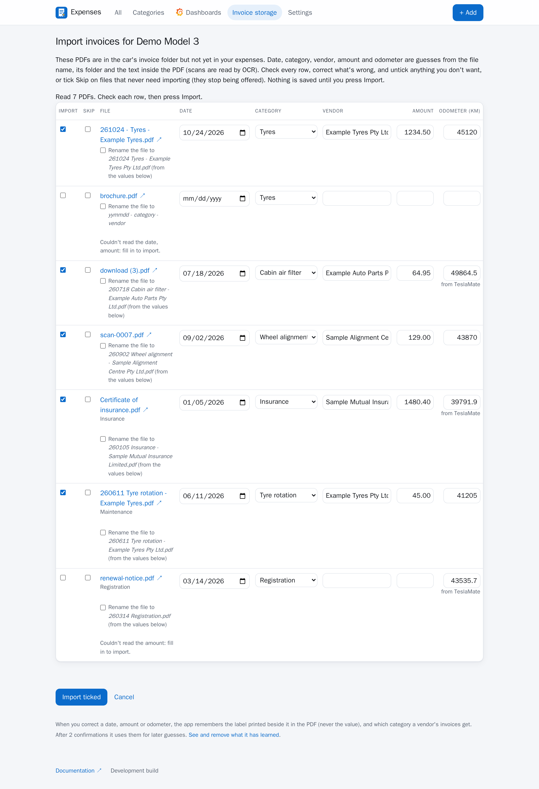

# Importing invoices

Invoices already in a car's folder (and its subfolders) can be turned into expenses in bulk, whether
that folder is in OneDrive or is the [invoice folder on the server](local-folder.md): on the
**Invoice storage** page, press **Import existing invoices** beside the car.

The page opens at once and shows its progress (looking in the folder, then "Reading 3 of 10" with the
file's name) while it reads every PDF that isn't yet linked to an expense. It guesses each one's date,
category, vendor, amount and odometer, and shows them in a table to check, correct and untick. **Nothing is saved until you press Import**, and a
file already linked to an expense never appears again. Tick **Skip** on files that never need
importing (a brochure, say) and they stop being offered; **Offer them again** at the foot of the page
brings them back. When you press Import with some files left unticked, the page asks whether to
skip those too; choose Cancel to leave them for next time.

## How it guesses

The guesses come from **the PDF itself first**, because file names are often arbitrary: its text
(`Invoice Date`, a `Total` line, `Odometer`, the company or trading name, and which category it is about:
named in its heading, or mentioned most). The folder you filed it in comes next for the category, and the
file name is only the fallback for what the PDF doesn't say: a leading or trailing `yymmdd` date, a category
name, and the vendor in `Tyres - Tyre Shop`. A file name the PDF contradicts (it says Tyres, the PDF is a
registration notice) isn't used for the vendor. Scanned PDFs with no text are read
by OCR, which is slower and rougher. When a `Total due` line offers several amounts (a registration renewal for 6 or 12 months), **Settings →
When an invoice offers several amounts** picks the largest (the default), the smallest, or leaves it blank for
you. An amount is never guessed without a clear total, and
rows missing a date, category or amount start unticked. The image includes `poppler-utils` and
`tesseract-ocr` for this; without them the app still runs and simply proposes less.

A blank odometer is filled from TeslaMate's last position before the invoice date. Each row can also
be **renamed** where it is (in OneDrive, or in the folder on the server) to the [file name template](onedrive.md#file-names), built from the values
you confirm; a name already taken leaves the file as it is, and the expense is still imported.

The same reading works on a single invoice: on **+ Add**, choosing the invoice PDF fills in the date,
amount, vendor, category (when the file name or a learned vendor says) and odometer it can read,
without touching anything you've already typed.

## Possible duplicates

Possible duplicates are flagged. Saving a new expense (the Add form) that has the same car and exactly
the same amount as one within 14 days either side asks first: it lists the match with a link to open it, and
**Save anyway** saves the new one regardless. The question comes before anything is uploaded or saved, and the
server asks again if the page's own check was skipped. The import preview does the same per file, leaving a
likely duplicate unticked with a link to the expense it resembles.

<!-- screenshot: duplicate-warning - The question asked before saving a possible duplicate -->

## The vendor

The vendor is the name the document trades under: a line such as `Example Insurer Limited ABN … trading as
Brand Cover` gives `Brand Cover`, not the legal company (only when the words before "trading as" read as a
company name, so a footnote about someone else's insurer doesn't count). A vendor in the file name
(`261030 - Wheel Alignment - Tesla.pdf`) still comes first, and without a trading name the company named at the
start of a line is used.

## Learning from your corrections

The importer learns from your corrections. When you change or fill in a date, amount or
odometer, it re-reads that PDF and finds your value in the text: the label printed beside it
(for example `Annual premium` or `Date of issue`) is remembered, never the value itself. It also
remembers which category you gave each vendor's invoices. A label or vendor is used for later
guesses once you've confirmed it twice; a learned label that finds two different values in one
PDF leaves the field blank rather than guessing. Nothing is learned if your value isn't in the
PDF text. **Import page → See and remove what it has learned** lists everything and lets you
delete it. This stores only short labels and vendor names, in the `expenses` schema.

<!-- screenshot: learned-page - The page listing what the importer has learned -->
