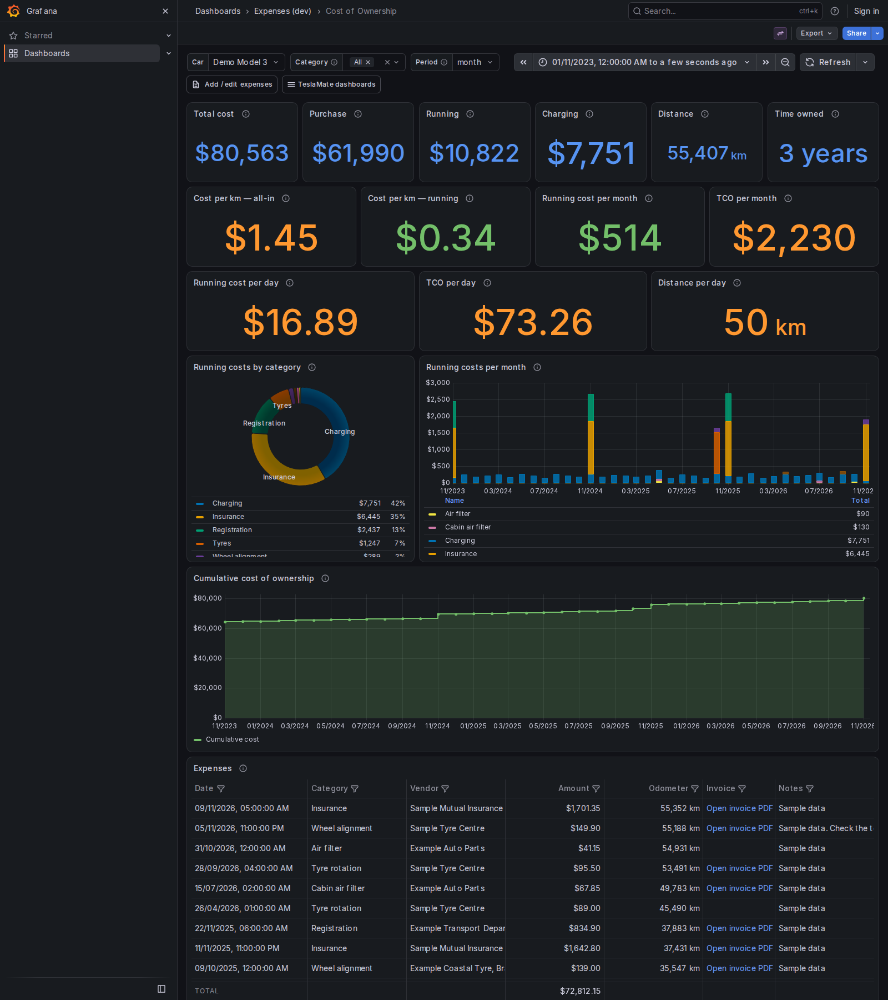
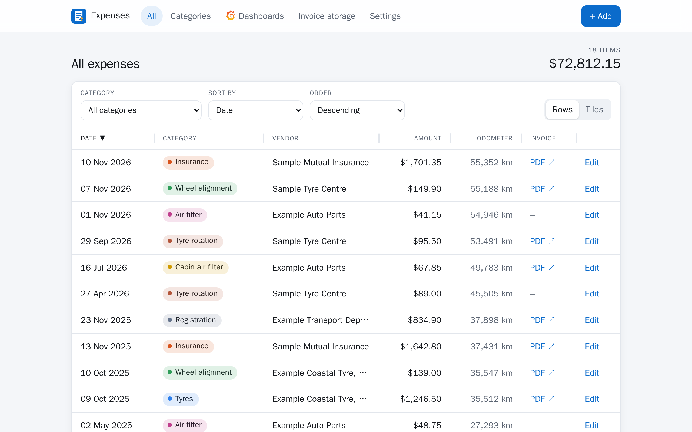
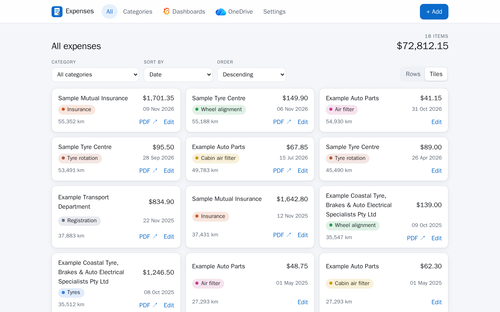
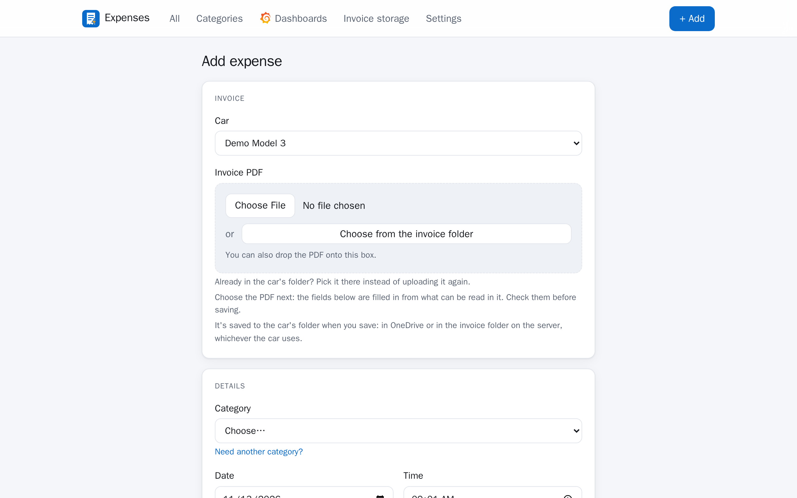

# GarageBooks

Track what your Tesla costs to own.
Record every expense (purchase, insurance, registration, tyres, servicing) in a small web app, and see
the total cost of ownership in TeslaMate's own Grafana, alongside the charging costs TeslaMate
already tracks.

!!! warning "Vibe coded"

    This project was written with an AI coding assistant (Claude Code), directed
    and tested by a person, not hand-written or audited line by line. It has tests, runs in a
    read-only, non-root container and only writes inside its own `expenses` schema, but treat it as
    you would any young, unreviewed software: back up your TeslaMate database before first use, and
    read the code before you trust it with anything you care about.

New here? Start with [Setup](setup.md).

## The dashboard

The **Cost of Ownership** dashboard in Grafana: total cost of ownership, purchase vs running vs
charging, cost per km, per day and per month, monthly spend by category, cumulative cost, and a
table of every expense with a link to its invoice. [What the dashboard counts](dashboard.md) explains
each figure.



## The expense list

Every expense, with its category colour, the total and a link to the invoice. Sort by any column,
either way (click a heading, or use **Sort by** and **Order**), and switch between rows and tiles with
the toggle beside the filter. In rows, drag the edge of a column heading to make that column wider or
narrower (double-click it for the usual widths); your widths are remembered in the browser. Refunds
and rebates show in green, and the app follows your device's light or dark setting.





## Adding an expense

Category, date, time, amount, odometer, vendor, notes and the invoice. The odometer can be filled in
from TeslaMate's own position data for the chosen date and time. The amount field works out sums
(`120.50+89.95`, `400/3`) when you leave it, press Enter or save, and has keys for the operators.
Editing an expense, then saving or cancelling, returns you to the category and order you were
looking at.



<!-- screenshot: amount-calculator - The amount field with a sum typed in and its result -->

Choosing the invoice PDF fills in what can be read from it. With
[OneDrive uploads](onedrive.md) on, the PDF goes into that car's OneDrive folder (choose it, or drop
it onto the invoice box) and the link is filled in for you. Or keep them on your own
server: with an [invoice folder](local-folder.md) mounted (a NAS share, say), the app saves the PDFs
there, per car and category, and shows them itself behind your login. Invoices already in either can be
[imported](importing.md) in bulk.

Starter categories: Initial purchase, Insurance, Registration, Tyres, Cabin air filter,
Air filter, Wheel alignment, Tyre rotation. Add more on the **Categories** page
(new ones count as running costs).

## How it fits together

The expenses live in their own `expenses` schema inside the TeslaMate database, so Grafana joins
them to TeslaMate's charging costs and odometer with no second datasource.

```
 browser ──► proxy + forward-auth ──► expenses (Flask/gunicorn) ──► TeslaMate Postgres
                                                                       ▲   schema `expenses`
                                     Grafana (TeslaMate datasource) ───┘   + public.* (read-only)
```

The app has no login of its own, so it must sit behind a forward-auth gate: see [Setup](setup.md).

## Notices

This project is an unofficial community tool and is not affiliated with, endorsed by, or supported by the official TeslaMate project. It reads data from a [TeslaMate](https://github.com/teslamate-org/teslamate) database. Not affiliated with Tesla, Inc.

OneDrive is a trademark of Microsoft Corporation and Grafana is a trademark of Grafana Labs. This
project is not affiliated with or endorsed by either. The OneDrive and Grafana logos are fetched at
runtime from [selfh.st/icons](https://selfh.st/icons)
([CC BY 4.0](https://creativecommons.org/licenses/by/4.0/)); they are not part of this repository.
