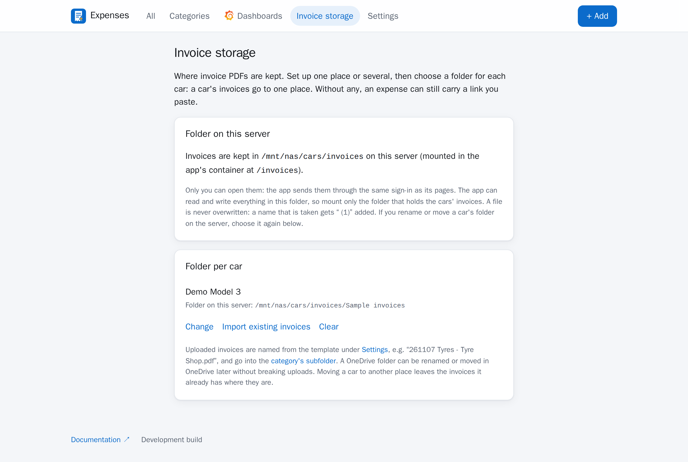
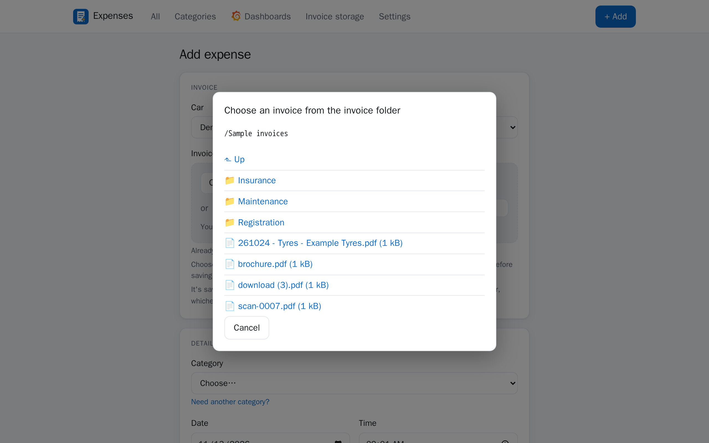

# Invoice folder on the server

Invoice PDFs can be kept in a folder on the server the app runs on, such as a NAS share mounted on
the Docker host, instead of in cloud storage. The app saves them there and shows them itself: the
**PDF** link in the expense list opens the file in your browser, through the same login as the rest
of the app.

It does what [OneDrive uploads](onedrive.md) does. The expense form takes the PDF, names it from the
template under **Settings → Invoice file name** and saves it into the category's subfolder of the
folder you chose for that car. Invoices already in the folder can be
[imported](importing.md), with the same preview and learning. Both can be on at once: each car uses
one or the other.



## Turning it on

A container only sees what is mounted into it, so the folder is mounted once and each car's folder is
then chosen inside it, in the app.

1. **Pick the folder on the server.** Use the narrowest folder that holds all the cars' invoices, for
    example `/mnt/nas/cars/invoices`: the app can read and write everything in it. It must already
    exist.

2. **Let the app write to it.** The app runs as user and group `10001`, not as root. See
    [Who owns the files](#who-owns-the-files) for a local disk, an SMB share and an NFS share.

3. **Name it in `.env`:**

    ```bash
    INVOICES_HOST_DIR=/mnt/nas/cars/invoices
    ```

4. **Start the app with `docker-compose.invoices.yml` added.** It mounts that folder at `/invoices`
    and sets the app's `INVOICES_DIR` to it.

    ```bash
    docker compose -f docker-compose.yml -f docker-compose.invoices.yml up -d
    ```

    Behind Traefik, list all three files (`-f docker-compose.yml -f docker-compose.traefik.yml -f
    docker-compose.invoices.yml`). The log then shows `invoice_folder=on`:

    ```bash
    docker compose logs expenses | grep started
    ```

5. **Choose a folder for each car** on the app's **Invoice storage** page, under **Folder per car**:
    browse into the folder, creating one with **New folder** if it doesn't exist yet, and press **Use**.
    The page's **Folder on this server** card shows the folder it is using, by the path you gave in
    `INVOICES_HOST_DIR`, and each car's folder is shown in full below it. Check that path is the share,
    not an empty folder on the server's own disk: see [If the share isn't mounted](#if-the-share-isnt-mounted).
    Choosing the first car's folder leaves a hidden file, `.teslamate-expenses`, at the top of the folder.

## If the share isn't mounted

Two things keep invoices from landing on the wrong disk when the share isn't there.

**The folder is missing.** If `INVOICES_HOST_DIR` doesn't exist at all, Docker refuses to start the
app (`create_host_path: false` in `docker-compose.invoices.yml`) instead of making an empty folder.

**Only the mount point is there.** This is the usual case: the share didn't mount, but the folder it
mounts on, `/mnt/nas/cars/invoices`, still exists on the server's own disk, empty. To the app that
looks just like an empty share, so it uses the hidden `.teslamate-expenses` file instead. It writes the
file when you choose a car's folder, and from then on, while any car keeps its invoices in this folder,
a folder without that file is treated as not mounted:

- the Invoice storage page says the folder isn't there and asks whether the share is mounted,
- saving an expense with a PDF says the same and saves nothing,
- browsing, choosing a folder, **New folder**, the file window and importing are refused,
- invoices in the list can't be opened until the share is back,
- nothing is written anywhere, so the server's own disk stays untouched.

Mount the share and reload the page; nothing in the app needs changing.

### Stopping instead of running without it

By default `docker-compose.invoices.yml` doesn't let the app run without its folder
(`INVOICES_REQUIRED=1`). If the folder is missing, or is only the empty mount point, when the app
starts, it logs why and stops:

```bash
docker compose logs expenses
```

```text
[ERROR] INVOICES_DIR /invoices can't be used, and INVOICES_REQUIRED=1, so the app won't start: The invoice folder (INVOICES_DIR) doesn't look like the one your cars use: it has no .teslamate-expenses file, ...
```

The container's restart policy (`restart: unless-stopped`) starts it again and again, so it comes up
by itself once the share is mounted; `docker compose ps` shows it as *Restarting* until then. If the
folder goes away while the app runs (the NAS restarts, say), its health check fails and
`docker compose ps` shows it as *unhealthy*, with the reason in the log.

To keep the app running while the share is down, so expenses can still be entered without their
invoices, set this in `.env` and start the app again. It then only warns, in the log and on the
Invoice storage page:

```bash
INVOICES_REQUIRED=0
```

Leave `.teslamate-expenses` where it is, and copy it along if you move the invoices to a new share. If
the app reports a folder you know is the right one (you deleted the file, say), either clear each car's
folder on the Invoice storage page and choose it again, which writes the file afresh, or create it
yourself:

```bash
touch /mnt/nas/cars/invoices/.teslamate-expenses
```

Before the first car's folder is chosen there is nothing to compare with, so check the path the page
shows then. Two habits make an unmounted share harder to miss:

- **Mount the share before Docker starts.** With systemd, `x-systemd.automount` in `/etc/fstab` mounts
  it the first time anything looks, and a share that can't be reached then gives an error rather than
  an empty folder. `nofail` keeps the server booting if the NAS is off.
- **Keep the bare mount point closed.** Leave the empty folder the share mounts on owned by root, as
  `mkdir` makes it (`sudo mkdir /mnt/nas/cars/invoices`), and don't give it to the app's user: then
  even before the first car is set up, nothing can be written there unless the share is mounted over it.

If you run the app some other way, the two things that matter are the mount and `INVOICES_DIR`, the
path of the folder inside the container. The container can't see where the folder is on the server,
so the page shows `INVOICES_HOST_DIR` when the app is given it, and the container's path otherwise.

## Who owns the files

The app writes invoices as the user it runs as, `10001:10001` unless you change it. That user needs
to read and write the folder.

- **A folder on a local disk.** Give it to the app:

    ```bash
    sudo chown -R 10001:10001 /mnt/nas/cars/invoices
    ```

- **An SMB (CIFS) share.** Ownership comes from the mount, not the files, so `chown` does nothing.
  Either mount it for the app's user, or run the app as the user it is already mounted for (below).
  A line in `/etc/fstab` on the Docker host that mounts a share for the app's default user, with the
  options above:

    ```text
    //nas.example.lan/invoices /mnt/nas/cars/invoices cifs credentials=/etc/samba/creds-nas,uid=10001,gid=10001,file_mode=0660,dir_mode=0770,_netdev,nofail,x-systemd.automount,x-systemd.mount-timeout=30 0 0
    ```

    Then make the mount point, have systemd pick up the new line, and mount it:

    ```bash
    sudo mkdir /mnt/nas/cars/invoices
    ```

    ```bash
    sudo systemctl daemon-reload && sudo mount /mnt/nas/cars/invoices
    ```

    A share already mounted for your own user (`uid=1000,gid=1000`, say) works just as well with
    `EXPENSES_UID=1000` and `EXPENSES_GID=1000`. If the two don't match, saving an invoice says *The app
    has no permission to write in the invoice folder* and writes nothing.

- **An NFS share.** Ownership is the numeric user and group on the NFS server. Either give the
  exported folder to `10001:10001` there, or run the app as the user that already owns it (below). An
  export with `all_squash` writes everything as its `anonuid`/`anongid`, whoever the app runs as, so
  that user must own the folder.

Invoices the app saves can be read by everyone on the server and written by their owner and group
(`664`), never by everyone. To keep them private to the owner and group, close the folder itself, as
nobody can open a file in a folder they can't enter (on a share, `dir_mode=0770` above does this):

```bash
sudo chmod 770 /mnt/nas/cars/invoices
```

To run the app as another user, set these in `.env` and start it again:

```bash
EXPENSES_UID=1000
EXPENSES_GID=1000
```

One thing to do when you change the user on an installation that has already run: the Grafana
dashboard file in the `teslamate-expenses-dashboards` volume still belongs to the old user, and the
app can no longer replace it (the log says `Could not write the Grafana dashboard`). Hand the volume
over once:

```bash
docker run --rm -v teslamate-expenses-dashboards:/d busybox chown -R 1000:1000 /d
```

When the app can't write, saving an expense with a PDF says *The app has no permission to write in
the invoice folder* and saves nothing. A car with no folder chosen is different: the expense is saved,
and the notice says the PDF wasn't uploaded.

## Using it

**Adding an invoice.** On **+ Add**, choose the PDF (or drop it on the invoice box) and save. The
file is written to a temporary file beside its final name and then moved into place, so a
half-written file is never seen. It is called `261107 Tyres - Tyre Shop.pdf` by default (the template
and its `%` aliases are described in [OneDrive uploads](onedrive.md)), and a name that is taken gets
` (1)` added: a file is never overwritten. The subfolder is set per category on the **Categories**
page, and is made the first time it is needed.

If the invoice is already in the folder, press **Choose from the invoice folder** instead. A window
opens over the form, in the car's folder: open a folder to go into it, or **Up** to go above it, as
far as the top of the mounted folder. Choosing a PDF makes it the expense's invoice and fills in the
form from what can be read in it. Nothing is copied or moved.



**Opening an invoice.** The **PDF** link in the expense list opens it in the browser's own PDF
viewer. The edit page shows the file's name, with a **Download** link beside it, and a box to remove
it from the expense (the file stays in the folder). The Grafana dashboard's expense table links to
it too, at the address under **Settings → This app's URL**, so set that. Whoever opens one goes
through the app's forward-auth login first; there is no public or share link.

**Importing.** **Invoice storage → Import existing invoices** beside a car reads the PDFs in its
folder and the folders below it that have no expense yet. See [Importing invoices](importing.md).

## Good to know

- **Each car uses one storage.** Both are set up on the one Invoice storage page. With both on, a car
  on OneDrive has **Move to a server folder** beside it, and the other way round. Expenses already
  saved keep the invoice they have: OneDrive links stay OneDrive links.
- **Moving files.** An expense stores the file's path below the mounted folder, so mounting the folder
  somewhere else on the host changes nothing. Renaming or moving a file or folder *inside* it by hand
  does break the link of every expense that points there (the app says *Invoice not found*). If you
  rename a car's folder, choose it again on the Invoice storage page.
- **Only inside the folder.** Every path is checked against the mounted folder before anything is read
  or written, and a symbolic link that leads out of it is refused. Only PDFs are saved or served (up
  to 20 MB, checked by content when uploaded). Files and folders whose names start with a dot, such
  as a NAS's recycle bin, are left out.
- **Backups.** The PDFs are not in the TeslaMate database, only their paths are. Back the folder up
  with whatever backs up the share, `.teslamate-expenses` included.
- **Turning it off.** Remove the compose file from the command and start the app again. The files stay
  where they are; expenses that point at them show no working link until it is back on.
