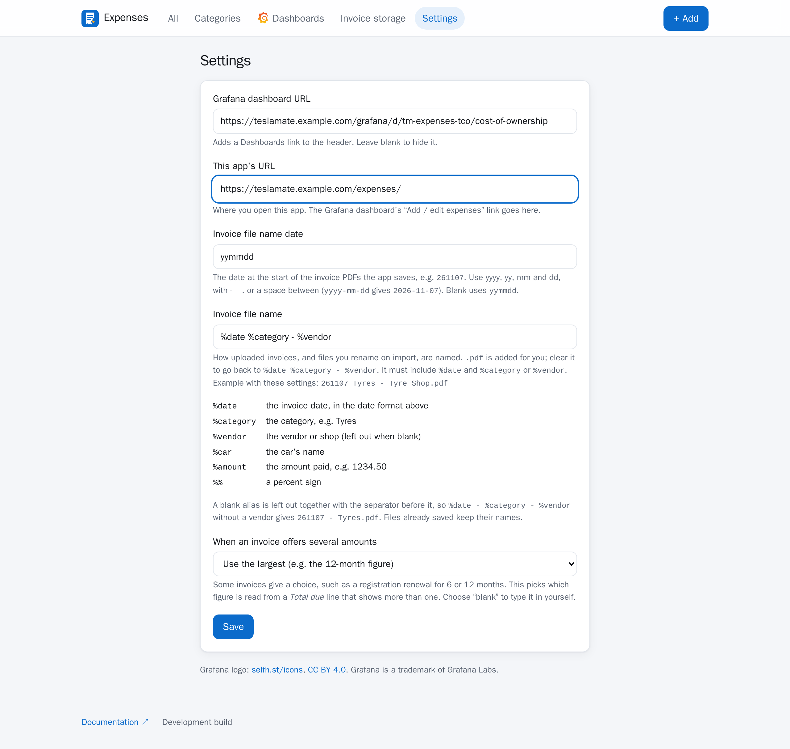

# Setup

!!! danger "No login of its own"

    The app has **no login of its own**. Only publish it behind a forward-auth gate, such as
    Authentik or Authelia with Traefik, or Cloudflare Access in front of a Cloudflare Tunnel (a worked
    example is in [Publishing with Traefik and Cloudflare](publishing.md)).
    `docker-compose.traefik.yml` refuses to start without a gate.

1. **Configure.** `cp .env.example .env`. Set `DATABASE_USER` and `DATABASE_PASS` to the same values
    TeslaMate and its other add-ons use (they're in TeslaMate's compose file), and `FQDN_TM` to the
    same value as TeslaMate's compose variable. `FQDN_TM` is read on first start only (step 7), so
    set it now. Set `APP_TZ` to your IANA timezone. For OneDrive, add the key from
    [OneDrive uploads](onedrive.md) now too, or later with a restart. To keep invoices in a folder
    on this server instead, see [Invoice folder on the server](local-folder.md).

2. **Back up TeslaMate's database.** The first start adds the `expenses` schema to it and changes
    nothing else, but take a backup first, as for any upgrade that touches the database.

3. **Run it.** Set `EXPENSES_IMAGE` to a released image, or leave it unset to build locally. Follow
    a release channel with `:rc` or `:latest`, or pin one version (see [RELEASING.md](https://github.com/mattew124/teslamate-expenses/blob/main/RELEASING.md)).

    ```bash
    docker compose up -d                                                     # localhost:8088/expenses/
    docker compose -f docker-compose.yml -f docker-compose.traefik.yml up -d # behind Traefik and forward-auth
    ```

    It joins TeslaMate's compose network (`TESLAMATE_NETWORK`, default `teslamate_default`). The
    app creates its schema by itself; see [The database](#the-database).

4. **Check it started.** The first start logs `schema created`, then
    `started: ... onedrive=on` (or `off` without the key) and `invoice_folder=off` (or `on` with
    a mounted invoice folder):

    ```bash
    docker compose logs expenses | grep -E 'schema|started'
    ```

    Behind forward-auth, open the address in a private window: it must send you to the login page.

5. **Somewhere for invoices (optional).** See [OneDrive uploads](onedrive.md) or
    [Invoice folder on the server](local-folder.md). Without either, an expense can still carry a
    link you paste.

6. **Grafana.** Each time it starts, the app writes its own dashboard to the
    `teslamate-expenses-dashboards` volume, so the dashboard always matches the version you run. Its
    timezone is your `APP_TZ` (there's no timezone box on the dashboard; it's set in the compose file,
    as in TeslaMate). Give TeslaMate's Grafana that volume and `grafana/provider.yml`, in TeslaMate's
    compose file:

    ```yaml
    services:
      grafana:
        volumes:
          - teslamate-expenses-dashboards:/dashboards-expenses:ro
          - /path/to/teslamate-expenses/grafana/provider.yml:/etc/grafana/provisioning/dashboards/expenses.yml:ro
    volumes:
      teslamate-expenses-dashboards:
        external: true      # created when you start this app's compose file
    ```

    Then recreate Grafana from TeslaMate's compose folder (a plain restart doesn't add new volumes):

    ```bash
    docker compose up -d grafana
    ```

    The dashboard appears under **Expenses** (datasource `TeslaMate`, tested on Grafana 13);
    [What the dashboard counts](dashboard.md) explains it.

    Provisioned dashboards can't be edited in Grafana. To customise it, import
    `grafana/cost-of-ownership.json` by hand instead (Dashboards → New → Import), set the `tz`
    variable to your IANA zone (Dashboard settings → Variables) and save, then set `DASHBOARD_DIR=`
    empty in `.env` so the app stops writing its own copy.

7. **Check the links.** On first start the app uses `FQDN_TM` to pre-fill its **Settings** page
    (the same idea as TeslaMate's): this app at `https://$FQDN_TM$BASE_PATH/` and the dashboard at
    `https://$FQDN_TM/grafana/d/tm-expenses-tco` (change the `/grafana` part with `GRAFANA_PATH`).
    Those addresses add a *Dashboards ↗* link to the app's header and make the dashboard's
    *Add / edit expenses* link go to the right place. After that, the Settings page is the only place
    to change them, and restarts never overwrite it. Without `FQDN_TM` they start empty, and you
    fill them in there.

    

## The database

There is nothing to run. On start the app creates its own `expenses` schema in the TeslaMate
database (idempotent, so upgrades apply themselves), and only ever writes inside it. It reads
`cars`, `positions` and `charging_processes`. This needs TeslaMate's database user, which
owns the database; Grafana already reads it the same way.

To give the app less than that, run `scripts/provision-db.sh` once. It creates a role that
can write expenses and read only `cars` and `positions(car_id, date, odometer)`. Point
`DATABASE_USER`/`DATABASE_PASS` at it and set `SKIP_MIGRATE=1`. Re-run the script on upgrades.
